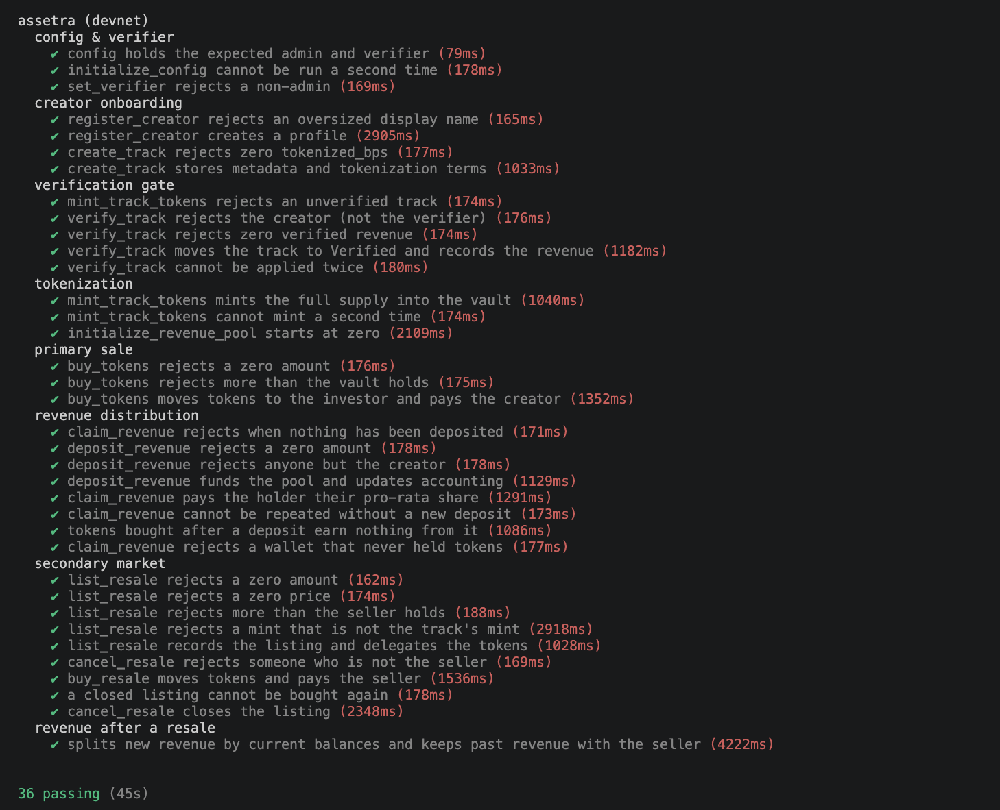
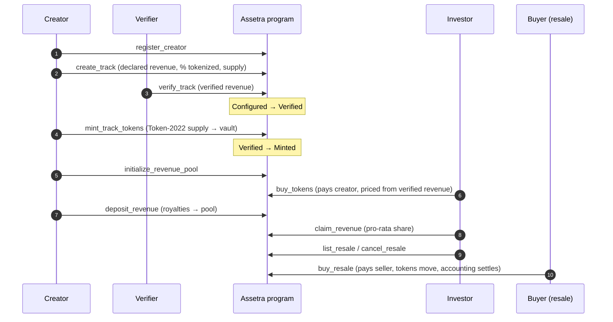
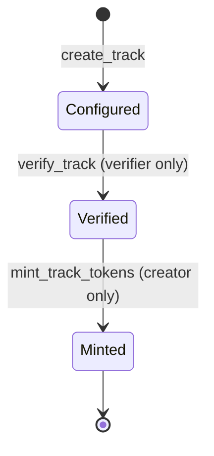
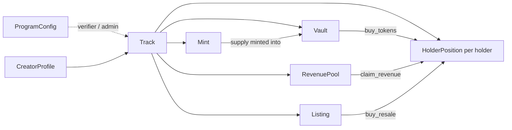
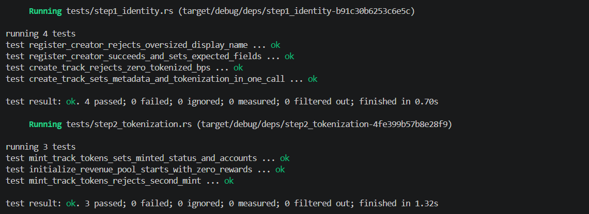
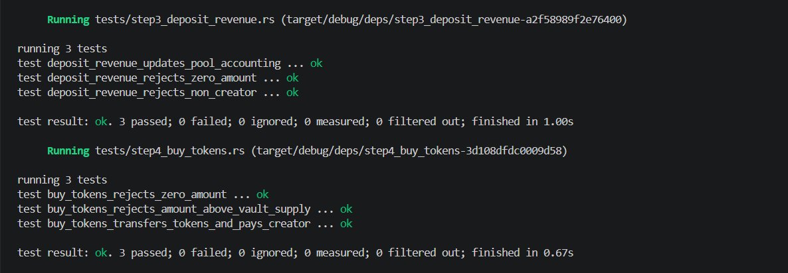

# Assetra — Music Royalty Tokenization on Solana

Assetra lets a music rights holder (an independent artist, in principle a label or publisher) tokenize a defined slice of a song's **future royalty income** — not the audio file, and not the copyright itself. Investors buy fractional Token-2022 tokens that represent a proportional claim on that income stream. As real-world royalties arrive they are deposited on-chain and distributed **pro-rata** to whoever holds the tokens at that time. Holders can resell their fractions on a secondary market at any time.

## Deployment

| | |
|---|---|
| Cluster | Solana **devnet** |
| Program ID | `FmS7DSf1d5KGNQtVy6usXFaHi7fNnTtiJofHZSQzGKYi` |
| Explorer | [View on Solana Explorer](https://explorer.solana.com/address/FmS7DSf1d5KGNQtVy6usXFaHi7fNnTtiJofHZSQzGKYi?cluster=devnet) |
| IDL | [`idls/assetra.json`](idls/assetra.json) |

## Tests passing on devnet

36 integration tests run against the **deployed devnet program** (real RPC, real Token-2022, real fees and rent):



Source: [`tests/assetra.devnet.ts`](tests/assetra.devnet.ts). A second, faster suite of 37 in-process tests (LiteSVM) lives in [`programs/assetra/tests`](programs/assetra/tests) and covers the same instructions.

| Area | What is checked |
|---|---|
| Config & verifier | config state; `initialize_config` cannot repeat; non-admin cannot rotate the verifier |
| Creator onboarding | oversized name rejected; profile created; zero `tokenized_bps` rejected; track metadata stored |
| Verification gate | unverified track cannot mint; only the verifier can verify; zero revenue rejected; no double verification |
| Tokenization | full supply minted into the vault; second mint rejected; revenue pool starts at zero |
| Primary sale | zero and over-supply amounts rejected; exact tokens moved and creator paid |
| Revenue distribution | exact pro-rata claim; no double claim; late buyers earn nothing from earlier deposits |
| Secondary market | list / cancel / buy rules; foreign mint rejected; closed listing cannot be bought |
| After a resale | new revenue splits by current balances; seller keeps revenue earned before the sale |

## Architecture

### Lifecycle



### Track status



Tokens can only be minted — and therefore sold — after the designated verifier has attested to the track's royalty data.

### Accounts (PDAs)

| Account | Seeds | Purpose |
|---|---|---|
| `ProgramConfig` | `["config"]` | admin and verifier keys (singleton) |
| `CreatorProfile` | `["creator_profile", authority]` | creator identity, track counter |
| `Track` | `["track", creator, track_id]` | metadata, tokenization terms, status, mint / vault |
| `Mint` (Token-2022) | `["mint", track]` | the royalty-share token, 0 decimals, authority = track PDA |
| `Vault` (token account) | `["vault", track]` | unsold supply, authority = track PDA |
| `RevenuePool` | `["revenue_pool", track]` | holds deposited royalties + reward accumulator |
| `HolderPosition` | `["holder_position", track, holder]` | per-holder reward accounting |
| `Listing` | `["listing", track, seller, nonce]` | a resale offer; also the token delegate |



### Instructions

| Instruction | Signer | What it does |
|---|---|---|
| `initialize_config` | admin | creates the config with the verifier key |
| `set_verifier` | admin | rotates the verifier (mock → real oracle later) |
| `register_creator` | creator | creates the creator profile |
| `create_track` | creator | declares a track and its tokenization terms |
| `verify_track` | verifier | attests the revenue; `Configured → Verified` |
| `mint_track_tokens` | creator | mints the supply into the vault; `Verified → Minted` |
| `initialize_revenue_pool` | creator | creates the royalty pool |
| `buy_tokens` | investor | primary sale from the vault, paid to the creator |
| `deposit_revenue` | creator | moves royalties into the pool |
| `claim_revenue` | holder | pays out the holder's accrued share |
| `list_resale` | seller | lists tokens at a price (approves the listing as delegate) |
| `cancel_resale` | seller | revokes the delegate and closes the listing |
| `buy_resale` | buyer | pays the seller, moves tokens, re-bases both positions |

### Pricing

```
price = verified_annual_revenue × valuation_multiple_bps × tokenized_bps × amount
        ───────────────────────────────────────────────────────────────────────
                        100 × 10_000 × token_supply
```

Primary-sale pricing uses the **verified** revenue figure, not the creator's declared one.

### Revenue accounting

Distribution uses the standard accumulator pattern, so deposits and claims are O(1) regardless of holder count:

- `RevenuePool.accumulated_rewards_per_token` grows by `deposit × 10^12 / token_supply` on every deposit.
- Each `HolderPosition` stores a `reward_debt`. On any balance change or claim the position is *settled*: `accrued = balance × accumulator − reward_debt`.
- `buy_tokens` and `buy_resale` settle both sides **before** balances change and then re-base `reward_debt`, so a buyer never receives revenue that predates their purchase, and a seller keeps what they earned while holding.

### Track verification (mock oracle)

Creators declare their royalty data, but a track cannot be minted until the configured **verifier** signs `verify_track`. The verifier is a single key stored in `ProgramConfig` and rotatable by the admin with `set_verifier`, so the mock verifier can later be replaced by a real attestation service (distributor / PRO statements, a multisig, an oracle) without changing the program interface.

## Security notes and known limitations

- **Verifier is trusted.** In this version it is a single key. It attests that declared data is real, but nothing on-chain proves royalties actually arrive.
- **Revenue deposits are creator-signed** and therefore self-reported. A production version should source deposits from, or have them attested by, the verifier or a payment source.
- **Resales must go through the program.** `list_resale` / `buy_resale` keep reward accounting correct; a raw Token-2022 transfer outside the program would bypass it.
- **`initialize_config` is first-come-first-served**, so it should be called immediately after deployment.
- `list_resale` requires the mint to be the track's own mint (prevents listing an unrelated token under a real track).

## Run it

```bash
# program + local tests (37, in-process LiteSVM)
anchor build && cargo test

# one-time devnet setup: creates the config and a verifier key (keys/verifier.json, git-ignored)
npx ts-node --transpile-only scripts/init-config.ts

# integration tests against the deployed devnet program (36)
RPC_URL=<devnet rpc> yarn test:devnet

# full lifecycle walk-through on devnet (prints each transaction)
npx ts-node --transpile-only scripts/demo-flow.ts
```

> `RPC_URL` is optional; without it the public devnet RPC is used, which rate-limits heavily.

## Earlier local test run (LiteSVM)

Snapshots from before the verifier and resale suites were added:



